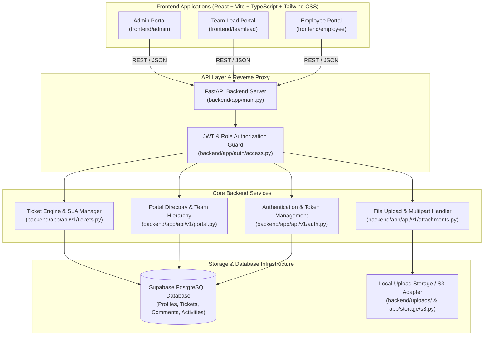
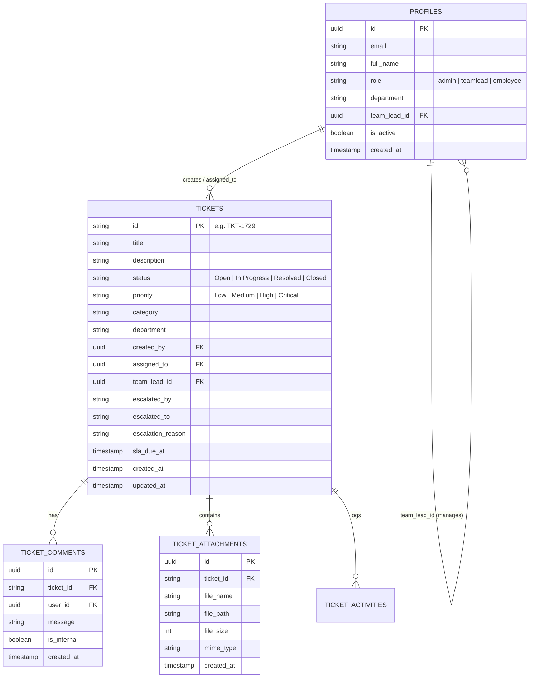

# KIVO Ticketing System — End-to-End Technical Documentation

> **Platform Tagline:** Track. Manage. Resolve.  
> **System Scope:** Multi-tenant/Role-based Enterprise IT Ticketing & Service Desk Management System  
> **Roles Supported:** Admin, Team Lead, Employee

---

## 1. Project Overview & Architecture

The **KIVO Ticketing System** is a distributed, enterprise-grade ticketing and service desk application designed to streamline internal issue reporting, department-based ticket routing, SLA (Service Level Agreement) enforcement, escalation workflows, team collaboration, and real-time activity tracking.

### High-Level Architecture



---

## 2. Repository Root Structure

Below is the directory map of the root repository and the purpose of each root file:

```
Ticketing-System-/
├── .agents/                      # AI Agent personas, QA automation rules & references
├── .github/                      # CI/CD automation & GitHub Pages deployment workflows
├── backend/                      # Python FastAPI REST backend & database connectors
├── frontend/                     # Multi-portal React Vite applications
│   ├── admin/                   # Admin Portal frontend
│   ├── teamlead/                # Team Lead Portal frontend
│   └── employee/                # Employee Portal frontend
├── e2e-tests/                    # Playwright end-to-end integration test suites
├── infra/                        # Infrastructure, container definitions, and deployment scripts
├── ticketing-system-frontend/    # Unified legacy/monolithic portal reference
├── docker-compose.yml            # Multi-service local development container orchestrator
├── Makefile                      # Make commands for setup, linting, tests, and builds
├── README.md                     # Project quickstart guide
├── render.yaml                   # Render.com cloud deployment blueprint
├── requirements.txt              # Top-level Python dependencies list
├── test_auth_verification.cjs    # Automated node regression test script for auth routes
└── test_db.py                    # Database connection and integrity test script
```

### Purpose of Root Files & Directories

| Item | Type | Purpose |
| :--- | :--- | :--- |
| `backend/` | Directory | Houses the Python FastAPI application, database adapters (Supabase/PostgreSQL), Alembic migrations, schemas, business services, and upload endpoints. |
| `frontend/` | Directory | Houses 3 specialized sub-frontends (`admin`, `teamlead`, `employee`) tailored to each persona's workflows, permissions, and dashboards. |
| `.agents/` | Directory | Automated agent skills, system prompt references, and QA testing rules used for autonomous regression checks and bug healing. |
| `.github/workflows/` | Directory | CI/CD pipelines including `deploy-pages.yml` (multi-frontend production builds deployed to GitHub Pages) and backend test runners. |
| `docker-compose.yml` | File | Defines Docker services for running the FastAPI backend, PostgreSQL, and Redis locally in containerized environments. |
| `render.yaml` | File | Infrastructure-as-code specification for deploying the FastAPI backend and workers directly to Render cloud platform. |
| `test_auth_verification.cjs` | Script | Node.js verification script ensuring all route guards, redirection paths (`/` -> `/login`), and authentication boundaries are intact. |

---

## 3. Backend Architecture & Folder Breakdown

The backend is built with **FastAPI** (Python 3.11+ / 3.12+), utilizing **Supabase PostgreSQL** via PostgREST and direct SQL connections, with JWT bearer tokens for role-based access control.

### Directory Structure: `backend/app/`

```
backend/
├── app/
│   ├── api/
│   │   └── v1/
│   │       ├── router.py             # Master APIRouter aggregating all v1 sub-routers
│   │       ├── auth.py               # Sign In, Sign Up, Token Refresh, Password Reset
│   │       ├── tickets.py            # Comprehensive Ticket lifecycle, SLA, Assignment, Escalation
│   │       ├── portal.py             # User Management, Departments, Team Leads, Employee cascades
│   │       ├── attachments.py        # Multipart file uploads, disk streaming, metadata recording
│   │       ├── auth_notifications.py # Email & webhook dispatch for ticket/auth triggers
│   │       ├── users.py              # User profiles & role fetching
│   │       └── health.py             # Liveness/Readiness probes (/health, /api/v1/health)
│   ├── auth/
│   │   ├── access.py                 # RBAC enforcement: verify_jwt, require_admin, require_team_lead
│   │   ├── user_store.py             # Persistent user CRUD directly against Supabase 'profiles'
│   │   ├── user_service.py           # Domain service for password hashing (bcrypt) and validation
│   │   └── email_service.py          # Notification transport for SMTP/transactional emails
│   ├── core/
│   │   ├── config.py                 # Pydantic BaseSettings loading .env configurations
│   │   ├── security.py               # JWT token creation, signature verification, PBKDF2/bcrypt hashing
│   │   └── errors.py                 # Custom HTTP exceptions and formatted error handlers
│   ├── db/
│   │   ├── base.py                   # SQLAlchemy DeclarativeBase
│   │   ├── session.py                # Database session generator (Scoped Session)
│   │   ├── supabase.py               # Supabase client singleton (Service Key + Anon Key)
│   │   ├── init_db.py                # Database table bootstrapper & schema integrity verification
│   │   └── models/                   # SQLAlchemy declarative ORM models
│   ├── schemas/
│   │   ├── user.py                   # Pydantic request/response schemas for users and authentication
│   │   └── ticket.py                 # Pydantic schemas for ticket creation, updates, and comments
│   ├── storage/
│   │   └── s3.py                     # S3-compatible cloud storage adapter (AWS S3 / Supabase Storage)
│   ├── worker/
│   │   ├── celery_app.py             # Celery distributed worker initialization (Redis broker)
│   │   └── tasks/                    # Background async tasks (SLA breach checks, batch emails)
│   └── main.py                       # FastAPI application factory, CORS middleware, lifespan events
├── supabase/
│   ├── complete_setup.sql            # Master database setup script (tables, foreign keys, triggers)
│   ├── rls_policies.sql              # Row Level Security (RLS) policies for Supabase
│   └── seed_users.sql                # Default initial administrator and team records
├── alembic/                          # Alembic database migrations
└── uploads/                          # Local ticket file attachment repository
```

### Why Each Backend Module Exists

1. **`app/main.py`**:  
   Initializes the FastAPI application, registers global CORS middleware allowing calls from all frontend origins, registers global exception handlers, and mounts the API router under the `/api/v1` prefix.

2. **`app/api/v1/tickets.py`**:  
   The core business engine. Manages ticket numbering (`TKT-XXXX`), priority scoring, SLA computation based on priority (`Critical` = 4h, `High` = 8h, `Medium` = 24h, `Low` = 48h), status transitions (`Open` → `In Progress` → `Resolved` → `Closed`), escalations, and timeline audits. Filters out internal `__activity__` metadata flags from chat views so user conversations remain clean.

3. **`app/api/v1/portal.py`**:  
   Exposes live organization structure APIs:
   - Queries real `profiles` to list all departments.
   - Filters active Team Leads by department (`GET /api/v1/portal/departments/{dept}/team-leads`).
   - Filters active Employees assigned to a specific Team Lead (`GET /api/v1/portal/team-leads/{lead_id}/employees`).
   - Handles Admin user management: permanent database user deletion (`DELETE /api/v1/portal/users/{user_id}`) with foreign-key cleanups.

4. **`app/auth/access.py`**:  
   Provides FastAPI dependency injection functions (`get_current_user`, `require_admin`, `require_team_lead`, `require_employee`). It decodes the Authorization Bearer header, validates JWT expiration, checks token blacklists, and enforces strict RBAC (Role-Based Access Control).

5. **`app/db/supabase.py`**:  
   Creates an authenticated Supabase client using `SUPABASE_URL` and `SUPABASE_SERVICE_ROLE_KEY`, providing database access that bypasses or obeys RLS as required by privileged backend operations.

---

## 4. Frontend Architecture & Folder Breakdown

The frontend adopts a multi-portal architecture separated into three independent applications under `frontend/`:
1. `frontend/admin` — Master admin oversight, SLA analytics, user management, and escalated ticket queues.
2. `frontend/teamlead` — Team workload balancing, ticket reviews, reassignments, and team escalations.
3. `frontend/employee` — Ticket creation, work queue, ticket progress updates, and resolution chats.

### Standard Sub-Frontend Structure

Each frontend portal follows this clean, scalable architecture:

```
frontend/<portal_name>/
├── public/                       # Static public assets (kivo-logo.png, favicon.ico)
├── src/
│   ├── assets/                   # Images, SVGs, and brand assets (kivo-logo.png)
│   ├── components/               # Reusable UI component library
│   │   ├── common/               # Badges, status pills, loaders, modal dialogs
│   │   ├── layout/               # Header, Sidebar, Shell, and Navigation containers
│   │   └── tickets/              # Ticket tables, conversation threads, activity logs
│   ├── layouts/                  # Master layout wrappers (DashboardLayout.tsx)
│   ├── pages/                    # Route-level page views (Sign In, Dashboard, Detail pages)
│   ├── routes/                   # App routing, RootRedirect, and ProtectedRoute guards
│   ├── services/                 # API client services (tickets, users, unifiedAuth)
│   ├── types/                    # TypeScript interfaces and data models (Ticket, User, SLA)
│   ├── App.tsx                   # React root component with RouterProvider and Toast contexts
│   ├── main.tsx                  # Vite DOM entry point
│   └── index.css                 # Tailwind CSS directives and custom typography styles
├── dist/                         # Production build output directory (HTML, JS, CSS)
├── package.json                  # NPM dependencies and build scripts
├── tsconfig.json                 # TypeScript compiler configuration
└── vite.config.ts                # Vite build and asset bundler configuration
```

### Why Each Frontend Directory Exists

| Directory | Why We Use It |
| :--- | :--- |
| `src/routes/` | Contains `AppRoutes.tsx` and `ProtectedRoute.tsx`. It ensures unauthorized users cannot navigate to private dashboard views. If an unauthenticated user hits `/`, they are redirected cleanly to `/login`. |
| `src/services/` | Centralizes all external HTTP network requests (`fetch` / `axios`). Separates UI views from network logic, handling auth token injection and error transformations. |
| `src/types/` | Defines contract interfaces between backend responses and React components, ensuring compile-time type safety across Ticket IDs, Statuses, and Roles. |
| `src/components/layout/` | Contains the top Header and Left Sidebar navigation, ensuring consistent brand layout (KIVO logo, dark navy `#0F172A` theme) across all screen sizes. |
| `src/pages/` | Contains view components corresponding to each URL route (`Dashboard.tsx`, `CreateTicket.tsx`, `UserManagement.tsx`, `EscalatedTickets.tsx`). |

---

## 5. Database Schema & Data Models

The system runs on **PostgreSQL (Supabase)**. The primary relational tables are:



---

## 6. Comprehensive API Reference (v1)

Base URL: `http://localhost:8000/api/v1` or `https://<backend-domain>/api/v1`

### 6.1 Authentication (`/auth`)

| Method | Endpoint | Description | Auth Required |
| :--- | :--- | :--- | :--- |
| `POST` | `/auth/login` | Authenticates user credentials (email & password), returns access token and user role. | None |
| `POST` | `/auth/signup` | Self-registration endpoint for employees. | None |
| `POST` | `/auth/refresh` | Refreshes an expired JWT access token using a valid refresh token. | Refresh Token |
| `POST` | `/auth/logout` | Invalidates active session tokens. | Bearer Token |
| `GET` | `/auth/me` | Fetches the currently authenticated user's profile details. | Bearer Token |

### 6.2 Organization & User Management (`/portal`)

| Method | Endpoint | Description | Auth Required |
| :--- | :--- | :--- | :--- |
| `GET` | `/portal/departments` | Returns list of all active departments in the organization. | Bearer Token |
| `GET` | `/portal/departments/{dept}/team-leads` | Returns only active Team Leads belonging to the selected department. | Bearer Token |
| `GET` | `/portal/team-leads/{lead_id}/employees`| Returns only active Employees assigned to the specified Team Lead. | Bearer Token |
| `GET` | `/portal/users` | Lists all users with their roles, departments, and active statuses. | Admin / TL |
| `POST` | `/portal/users` | Admin adds a new user (with role, department, and team lead assignment). | Admin |
| `DELETE`| `/portal/users/{user_id}` | Permanently deletes a user from the database and revokes credentials. | Admin |

### 6.3 Tickets & Escalation (`/tickets`)

| Method | Endpoint | Description | Auth Required |
| :--- | :--- | :--- | :--- |
| `GET` | `/tickets` | Lists tickets with role-based visibility, status/priority filters, and pagination. | Bearer Token |
| `POST` | `/tickets` | Creates a new ticket, computes SLA due date, and sends assignment notifications. | Bearer Token |
| `GET` | `/tickets/{ticket_id}` | Retrieves full ticket details, conversation thread, and audit log. | Bearer Token |
| `PATCH`| `/tickets/{ticket_id}` | Updates ticket status (`In Progress`, `Resolved`), priority, or assignment. | Bearer Token |
| `POST` | `/tickets/{ticket_id}/escalate`| Escalates a ticket, recording who escalated, who received, and the reason. | TL / Employee |
| `GET` | `/tickets/escalated/all` | Fetches all escalated tickets for the Admin Escalated Tickets dashboard table. | Admin |
| `POST` | `/tickets/{ticket_id}/comments`| Adds a chat reply or internal note to the ticket conversation. | Bearer Token |

### 6.4 File Attachments (`/attachments`)

| Method | Endpoint | Description | Auth Required |
| :--- | :--- | :--- | :--- |
| `POST` | `/attachments/upload` | Uploads multipart form files associated with a ticket ID. | Bearer Token |
| `GET` | `/attachments/{attachment_id}`| Streams/downloads the requested attachment file. | Bearer Token |

---

## 7. Role-Based Permissions & Access Matrix

| Feature / Action | Admin | Team Lead | Employee |
| :--- | :---: | :---: | :---: |
| **View All Organization Tickets** | Yes | No (Team tickets only) | No (My tickets only) |
| **Create Ticket** | Yes | Yes | Yes |
| **Assign / Reassign Ticket** | Yes | Yes (Within team) | No |
| **Escalate Ticket to TL / Admin** | N/A | Yes | Yes |
| **Reply to Conversation (My Tickets)** | Yes | Yes | Yes |
| **Reply to Conversation (All Tickets view)** | View-Only | N/A | N/A |
| **User Management (Add / Delete Users)** | Full Access | No | No |
| **Department / SLA Policy Setup** | Full Access | No | No |

---

## 8. Deployment & CI/CD Pipeline

The project is configured for continuous integration and automated deployment:

1. **Frontend Hosting (GitHub Pages):**  
   Managed via `.github/workflows/deploy-pages.yml`. When changes merge to the `main` branch:
   - Builds all three frontends (`admin`, `teamlead`, `employee`).
   - Copies SPA fallback handlers (`404.html`) and disables Jekyll (`.nojekyll`) for direct client routing.
   - Deploys compiled production bundles directly to GitHub Pages.

2. **Backend Hosting (Render / Docker):**  
   - Configured via `render.yaml` or containerized with `docker-compose.yml`.
   - Automatically executes DB integrity checks (`init_db.py`) on boot before starting Uvicorn workers.

